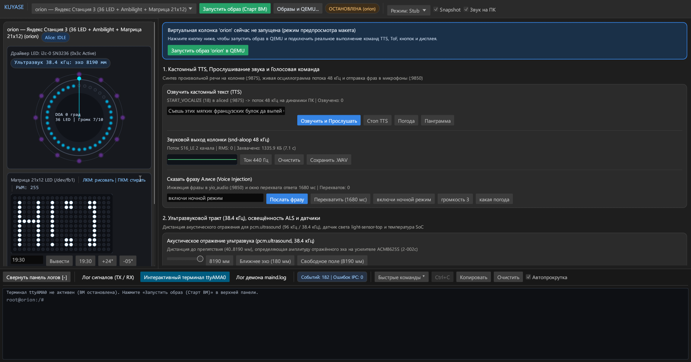
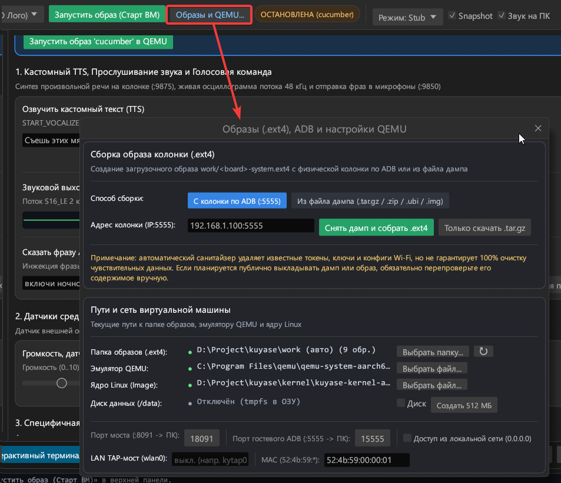

# КУЯСЭ! (`KUYASE`) — (К)устарный (У)ниверсальный (Я)ндекс (С)танций (Э)мулятор

**КУЯСЭ** — кроссплатформенный эмулятор умных колонок Яндекса (GUI и CLI) на базе QEMU с визуализацией периферии, выводом звука на ПК, доступом по ADB (:15555) и встроенным сборщиком образов .ext4.

>[!tip]
> Изначально была идея назвать проект как **Х**ороший **У**ниверсальный **Я**ндекс **С**танций **Э**мулятор, но проект ~~сделан на слопговнокоде~~ имеет стадию PoC

>[!warning]
> **Дампы прошивок не входят в репозиторий**
>
> Репозиторий содержит только исходный код Cargo Workspace (`protocol`, `hw-bridge`, `kuyase`), гостевой инициализатор и конфигурацию ядра Linux. Дамп прошивки необходимо снять со своей колонки по ADB (см. [`DUMP_GUIDE.md`](./DUMP_GUIDE.md)), собрать или взять из тематических ресурсов.


---

## Быстрый старт (готовая портативная сборка)

Для запуска готовой сборки из [**GitHub Releases**](https://github.com/vypivshiy/kuyase/releases) (`kuyase-win64-portable.zip` для Windows x64 или `kuyase-linux64-portable.tar.gz` для Linux x64) не требуется устанавливать Rust, WSL2 или `adb` — пропатченное гостевое ядро `kuyase-kernel-arm64.img`, гостевой инициализатор и демон `qemu-hw-bridge` уже включены в архив.

### 1. Установка QEMU

* **Windows x64** (через `winget` или официальный установщик):
  ```powershell
  winget install SoftwareFreedomConservancy.QEMU
  ```
  *(Либо скачайте установщик с [qemu.org/download/#windows](https://www.qemu.org/download/#windows) — по умолчанию ставится в `C:\Program Files\qemu\qemu-system-aarch64.exe` и подхватывается автоматически).*
* **Linux x64**:
  ```bash
  sudo apt update && sudo apt install -y qemu-system-arm
  ```

### 2. Распаковка и первый запуск

1. Скачайте портативный архив для своей ОС со страницы [**Releases**](https://github.com/vypivshiy/kuyase/releases) и распакуйте в любую папку:
   * **Windows**: распакуйте `kuyase-win64-portable.zip` и запустите `kuyase.exe`.
   * **Linux**: распакуйте `tar -xzf kuyase-linux64-portable.tar.gz` и запустите `./kuyase`.
2. В верхней панели нажмите кнопку **«Образы и QEMU...»** и подготовьте образ `.ext4`:
   * **С физической колонки по сети**: на вкладке **«С колонки по ADB (:5555)»** введите адрес колонки (`192.168.1.100:5555`) и нажмите **«Снять дамп и собрать .ext4»** — программа скачает системный раздел и сразу соберёт образ `work/<board>-system.ext4`.
   * **Из архива дампа**: переключитесь на вкладку **«Из файла дампа (.tar.gz / .zip / .ubi / .img)»**, нажмите **«Выбрать файл...»**, укажите архив дампа и нажмите **«Собрать .ext4»**.
   * **Если уже есть готовый образ `*-system.ext4`**: просто положите его в папку `work/` (или укажите свою папку через **«Папка образов (.ext4):» -> «Выбрать папку...»**) — пересобирать его не нужно, он сразу появится в списке плат.
3. Выберите образ в верхнем списке и нажмите **«Запустить образ (Старт ВМ)»**.

---

## Сборка из исходников (Windows и Linux)

### 1. Требования

* **Rust** (`rustup`, `cargo`) с установленным таргетом `armv7-unknown-linux-musleabihf` для гостевого моста:
  ```bash
  rustup target add armv7-unknown-linux-musleabihf
  ```
* **QEMU** (`qemu-system-aarch64` в `./bin/`, `./Releases/` или системном `PATH`).
* **Гостевое ядро Linux** (`./kuyase-kernel-arm64.img`, `./kernel/kuyase-kernel-arm64.img` или `./Releases/kuyase-kernel-arm64.img` — можно скачать из [**GitHub Releases**](https://github.com/vypivshiy/kuyase/releases)).

### 2. Сборка гостевого моста и десктопного приложения

На **Windows (PowerShell)** или **Linux (Bash)**:

```bash
# 1. Кросс-компиляция гостевого демона qemu-hw-bridge (статический musl ELF):
cargo build --release -p qemu-hw-bridge --target armv7-unknown-linux-musleabihf
cp -f target/armv7-unknown-linux-musleabihf/release/qemu-hw-bridge guest-init/bin/qemu-hw-bridge

# 2. Сборка нативного приложения и CLI-раннера kuyase:
cargo build --release -p kuyase
```

### 3. Пересборка гостевого ядра `kernel/Image` (опционально, Linux)

Если требуется пересобрать гостевое ядро Linux `6.6.60` (`arm64`, с `CONFIG_COMPAT=y`, патчами `i2c-stub` и тремя виртуальными фреймбуферами `vfb`):

```bash
sudo apt update && sudo apt install -y \
  git curl wget xz-utils build-essential gcc-aarch64-linux-gnu \
  flex bison bc libssl-dev libelf-dev dwarves

./kernel/build-kernel.sh
```

---

## Использование (GUI и CLI)

### Графический интерфейс (GUI)



* **Верхняя панель**: выбор образа `work/<board>-system.ext4`, запуск/остановка ВМ, окно **«Образы и QEMU...»** (снятие дампа по ADB, сборка `.ext4`, диск `/data`, порты и `LAN TAP`), режим `Stub / Full`, чекбоксы `Snapshot` и `Звук на ПК`.
* **Слева**: кольцо LED, `Ambilight` (`orion`), логотип, угол `DOA` (клик по кольцу), часы или матрица `21×12` (**ЛКМ** — рисовать, **ПКМ** — стирать) и кнопки корпуса (`uinput`).
* **Справа**: озвучка текста (`TTS`), вывод звука `48 кГц` и сохранение `.wav`, отправка голосовых команд (окно перехвата `1680 мс`), ползунки датчиков (`ToF`, ультразвук, `ALS`, температура) и выбор `.led`-паттернов.
* **Снизу**: лог пакетов моста (`TX / RX`), консоль `ttyAMA0` (с `Tab`-автодополнением и меню **«Быстрые команды ▾»**) и хвост `/tmp/daemons_logs/maind.log`.

>[!tip]
> По умолчанию включён **Snapshot (`-snapshot`)**: системный образ `work/<board>-system.ext4` не меняется, все правки живут в ОЗУ до выключения ВМ. Чтобы сохранять данные в `/data` между перезапусками (например, установленный `yam`), включите диск `/data` в окне **«Образы и QEMU...»**.

### Командная строка (CLI) и Headless-стенд

Все операции доступны без графического интерфейса (для скриптов/E2E-тестов):

```bash
# 1. Снять чистый дамп rootfs.tar.gz с физической колонки по сетевому ADB (:5555):
kuyase dump 192.168.1.100

# 2. Собрать образы work/<board>-system.ext4 из всех дампов в backups/ (или из конкретного файла):
kuyase prepare
kuyase prepare --dump ./backups/dump-yandexmini-20261029_120000

# 3. Прогнать свою команду или скрипт внутри каждой собранной колонки (armhf + aarch64):
kuyase run --headless --board all --exec "uname -m && cat /tmp/quasar-emu-hw.json"

# 4. Выполнить команду на конкретной плате (в чистом -snapshot) и вывести снимок состояния:
kuyase run --headless --board orion --exec "/tmp/my-test.sh"

# 5. Запустить фоновый безголовый стенд (работает до Ctrl+C, доступны ADB :15555 и мост :18091):
kuyase run --headless --board cucumber --keep-alive

# 6. Встроенный комплексный автотест всей эмулируемой периферии и IPC (все платы или одна):
kuyase test
kuyase test --board yandexmini
```

Демо-скрипт с примером автотеста пакетного менеджера для Яндекс Станций [`yam`](https://github.com/nyakokitsu/yam) по всей линейке колонок находится в каталоге [`examples/`](./examples/README.md).

### Сетевые порты виртуальной машины

* **ADB (`127.0.0.1:15555` -> гостевой `:5555`, `root`)**: поддерживается как встроенным клиентом `kuyase`, так и стандартной утилитой `adb`:
  ```bash
  adb connect 127.0.0.1:15555
  adb -s 127.0.0.1:15555 shell
  ```
* **Дуплексный мост периферии (`Hardware Bridge`)**: `127.0.0.1:18091` -> гостевой `:8091` (флаг `--bridge-port`, бинарный протокол `[u8 kind][u32_le len][payload]`, описан в [`protocol/src/lib.rs`](./protocol/src/lib.rs)).
* **Пользовательский порт**: `127.0.0.1:18090` -> гостевой `:8090`.

---

## Поддерживаемые устройства

Модель колонки и конфигурация эмулируемой периферии определяются автоматически по `/system/vendor/quasar/quasar.cfg`, `/boot/*.dtb`, `/etc/init.d/*` и `/system/vendor/quasar/ledpatterns/*.led`.

### Устройства, на дампах которых собраны и проверены образы

| Код | Модель | Userspace | Устройства |
| :--- | :--- | :--- | :--- |
| `yandexmini` | Станция Мини (`YNDX-0004`) | 32-bit `armhf` | 6-LED кольцо I2C `SN3236` (`0x3c`), лазерный дальномер `VL53L0X` (`ToF`), 4 микрофона |
| `yandexmini2` | Станция Мини 2 с часами (`YNDX-00021`) | 32-bit `armhf` | 6-LED кольцо `mini2:*:ring1..6`, 7-сегментные часы `mini2:white:clock*`, датчик света `LTR-308` (`ALS`), 4 микрофона |
| `yandexmini2nc` | Станция Мини 2 без часов (`YNDX-00020`) | 32-bit `armhf` | 6-LED кольцо `mini2:*:ring1..6`, датчик света `LTR-308` (`ALS`), 4 микрофона |
| `yandexmicro` | Станция Лайт (`YNDX-00025`) | 32-bit `armhf` | 3-LED кольцо `micro:*:ring1..3`, 4 микрофона |
| `plum` | Станция Лайт 2 с часами (`yandex,plum`) | 32-bit `armhf` | 3-LED кольцо `plum:*:ring1..3`, 7-сегментные часы `plum:white:clock*`, датчик света `LTR-308` (`ALS`), 2 микрофона |
| `plumnc` | Станция Лайт 2 без часов (`yandex,prune`) | 32-bit `armhf` | 3-LED кольцо `plum:*:ring1..3`, датчик света `LTR-308` (`ALS`), 2 микрофона |
| `station2` | Станция 2 (`YNDX-00051` / `yandex,station-midi`) | 32-bit `armhf` | 88-LED RGBW панель (`/dev/fb0` + `station2:*:ring0..87`), датчик света `LTR-308` (`ALS`), 4 микрофона |
| `cucumber` | Станция Миди (`YNDX-00054`) | 64-bit `aarch64` | 24-LED кольцо (`/dev/fb0`), 6-LED логотип (`/dev/fb1`), 7-сегментные часы `cucumber:white:clock-*`, датчик света `LTR-308` (`ALS`), 4 микрофона |
| `orion` | Станция 3 (`YNDX-00055`) | 64-bit `aarch64` | 36-LED кольцо (`/dev/fb2`), 12×2 RGBW эмбиент (`/dev/fb0`), монохромный LED-экран `21×12` (`/dev/fb1`, `gowin_led_device`), 4× усилителя `ACM8625S` (`2-002c`, `3-002c..2e`), ультразвук TDM (`hw:0,0`, `96 кГц` / `38.4 кГц`), датчик света `LTR-308` (`ALS`), 6 микрофонов |

### Не протестированные устройства (нет дампов)

Заложен автопрофиль, требуется тестирование на реальных дампах и доработка `hw-bridge` и UI для рендера схемы периферии — корректная эмуляция не гарантируется:

| Код | Модель | Userspace | Устройства |
| :--- | :--- | :--- | :--- |
| `bergamot` | Станция Мини 3 | 32-bit `armhf` | 6-LED кольцо (`/dev/fb0`), LED-часы, 4 микрофона |
| `pickle` | Станция Мини 3 Про | 64-bit `aarch64` | 16-LED кольцо, 6-LED логотип, 36-сегментные часы, датчик света `LTR-308` (`ALS`), 4 микрофона |
| `mango` | Станция Стрит | 32-bit `armhf` | 3-LED логотип RGBW, 4-LED индикатор заряда |
| `saturn` | Умный хаб Яндекса | 32-bit `armhf` | 1 RGB-светодиод статуса (без аудио и микрофонов) |

>[!warning]
> **Устройства на базе Android (YaOS) не поддерживаются**
>
> Эмулятор рассчитан только на Linux-прошивки (Buildroot + нативный стек `maind`). Устройства на базе Android / YaOS (где стек Quasar поставляется в виде APK поверх Android Runtime с проверкой `AVB` / `dm-verity`) **не поддерживаются**:
> * Яндекс Станция (1-го поколения, `tulip-d1` / `YNDX-0001`, Android 6)
> * Яндекс Станция Макс (`yandexstation_2` / `YNDX-0008`, YaOS / Android 9)
> * Яндекс Станция Макс с Zigbee (`yandexstation_2` / `YNDX-00052`, YaOS / Android 9)
> * Яндекс Станция Дуо Макс (Android / YaOS)
> * Все модели Яндекс ТВ Станций и медиаплееров

---

## Эмулируемая периферия и подсистемы

| Подсистема | Программная заглушка в `KUYASE` |
| :--- | :--- |
| **Процессор, ядро и Device Tree** | Виртуальная машина `qemu-system-aarch64 -M virt -cpu cortex-a53` с ядром Linux `6.6.60` (`CONFIG_COMPAT=y` для одновременной поддержки `32-bit armhf` и `64-bit aarch64` userspace). Дерево `/proc/device-tree` (`model`, `compatible`, `amlogic-dt-id`) синтезируется и монтируется поверх `tmpfs` автоматически по профилю платы |
| **Светодиоды, часы и экран (`LED` / `FB` / `I2C`)** | Драйвер `i2c-stub` (`/dev/i2c-0` на адресах `0x3c`, `0x21`, `0x37`: контроллер `SN3236` эмулирует теневые регистры BGR `0x01..0x12`, защёлку `0x25` `Register Latch`, блокировку `Stealth Lock` по `0x00` и сброс по `0x4a`), виртуальные фреймбуферы `vfb` (`/dev/fb0..2`) и дерево `/sys/class/leds/*` (с контролем триггера `ledfb-ring` и счётчиком `Trigger Conflict`). Состояние вычитывается демоном `qemu-hw-bridge` и отрисовывается в GUI |
| **Аудио, усилители и микрофонная матрица (`ALSA`)** | Звуковая петля `snd-aloop` (`Loopback`, `hw:0,0` <-> `hw:0,1`), программный регулятор громкости `softvol` (`Master`), эмуляция 4× усилителей `ACM8625S` и ультразвукового TDM-тракта `pcm.ultrasound` (`96 кГц` / `38.4 кГц` на `orion`). Звук перехватывается из `hw:0,1` в приложение `kuyase`, воспроизводится на хосте, отображается на осциллограмме и сохраняется в `.wav` |
| **Синтез речи (`TTS` / `START_VOCALIZE`)** | Вместо облачного нейроголоса Татьяны Шитовой ~~всратый процедурный бубнёж как у NPC в инди-играх~~ легковесный формантный вокодер на `sin()` и белом шуме. Звучит жутковато, но примерно моделирует длительность фразы и заполняет буфер `snd-aloop` |
| **Кнопки и датчики (`ALS`, `Temp`, `DOA`, `ToF` на `yandexmini`)** | Инжекция физических нажатий через `/dev/uinput` (`KEY_VOLUMEUP`, `KEY_VOLUMEDOWN`, `KEY_MUTE`, `KEY_VOICECOMMAND`), оптический дальномер жестов `VL53L0X` (`ToF` только на `yandexmini`), файловые стабы датчика освещённости `ALS` в `/sys/bus/iio/devices/iio:device0/*` и температуры SoC в `/sys/class/thermal/thermal_zone0/temp` |
| **Стек демонов Quasar (`maind`) и локальный IPC** | В режиме `Stub` демон `qemu-hw-bridge` поднимает локальный мок-сервер Protobuf IPC по схеме дампов из проекта [`v3rt3p/quasar-protos`](https://github.com/v3rt3p/quasar-protos) (`[u32_le_len][QuasarMessage]`): сокеты `aliced` (`:9875`), `yio_audio` (`:9850`), `iohub_services` (`:9903`) и эмуляцию лога `/tmp/daemons_logs/maind.log` (подробнее ниже) |

### Как работает мок-сервер IPC Quasar (`Stub Mode`)

Для отладки сторонних сервисов, скриптов и SDK (которые на реальной колонке общаются с `maind` по локальным TCP-сокетам и читают `maind.log`) демон `qemu-hw-bridge` эмулирует протокол фрейминга `[u32_le_len][QuasarMessage protobuf]`:

* **`aliced` (`127.0.0.1:9875`, `QuasarMessage.remoting`)** — принимает управляющие пакеты:
  * `START_VOCALIZE`: озвучивает переданный текст через формантный синтезатор в `snd-aloop` и пишет переходы `SPEAKING` -> `IDLE` в `maind.log`;
  * `CANCEL_DIALOG_AND_CLEAR_QUEUE` (`6`) и `STOP_TTS` (`14`): прерывают текущий TTS либо подавляют штатный автоответ Алисы при перехвате диалога (`aliced_hijack_count`);
  * `DeviceStateCapability`: переключает состояние микрофонов (`mics_muted`);
  * `AliceCapabilityMethod` и `PlaybackControlCapabilityMethod`: логируются и валидируются парсером (некорректный Protobuf увеличивает `ipc_error_count`).
* **`yio_audio` (`127.0.0.1:9850`)** — при подключении клиента каждые `40 мс` стримит кадры виртуальной микрофонной матрицы: 4 сырых канала (`raw_mic_0..3`), канал `vqe_0`, текущий угол `DOA` (`0..359°`) и амплитуду `RMS` (обнуляется при `Mute` и даёт всплеск при голосовой инжекции).
* **`iohub_services` (`127.0.0.1:9903`, `IOControlCommand`)** — принимает подписки клиентов (`RetrieveStateHandshake`, `ServiceReady`), пакеты `external_directives` (JSON) и команды `IOControlCommand`.
* **Инжекция голоса и окно перехвата (`Hijack Window`, `1680 мс`)** — при отправке фразы из GUI или CLI мост переводит состояние в `LISTENING`, дописывает в `/tmp/daemons_logs/maind.log` строку `[sdk] onRequestStateChanged: LISTENING, recognizedPhrase='...'` и ждёт `1680 мс`. Если за это время сторонний демон пришлёт `CANCEL_DIALOG_AND_CLEAR_QUEUE` или `STOP_TTS` в `:9875`, диалог считается перехваченным; иначе эмулятор сам озвучит штатный автоответ (`Выполняю: <фраза>`).

### Что не эмулируется

* **Стек `maind` и облачные сервисы Яндекса**: по умолчанию эмулятор работает в режиме **`Stub`** (`quasar.mode=stub`), где сокеты `:9875`, `:9850`, `:9903` и синтез речи обслуживает `qemu-hw-bridge`. Переключатель в режим **`Full`** (`quasar.mode=full`, запуск оригинального `/system/vendor/quasar/onboot.sh` и `maind`) почти не тестировался и вряд ли будет полноценно работать, так как в образах отсутствуют ключи, токены и данные авторизации в экосистеме Яндекса.
* **Беспроводные контроллеры**: чипы Wi-Fi/Bluetooth (`wlan0`, `hci0`) и Zigbee-координатор (`ttyS2` / `zigbee_control`) отсутствуют — сеть работает через виртуальный `virtio-net-pci` (`eth0`).
* **Аппаратные ускорители**: нейроускоритель `NPU` (`galcore`) и аппаратный аудио-DSP (`HiFi4`).
* **Криптохранилище и ключи устройства**: разделы `NAND nv`, `OTP efuse`, `unifykeys` и защищённая среда `OP-TEE` (`keymaster`).
