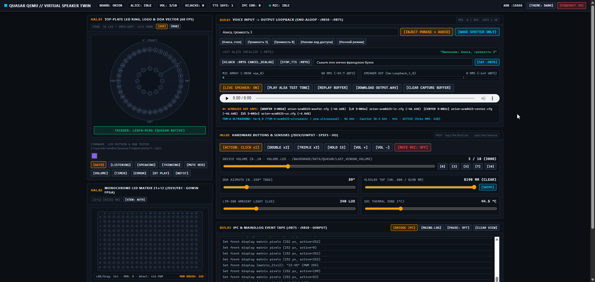
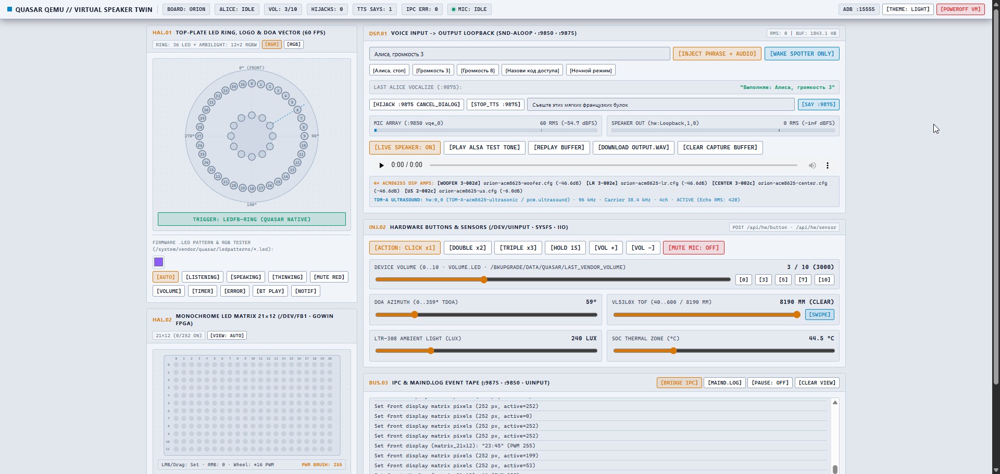

# КУЯСЭ! (`KUYASE`) — (К)устарный (У)ниверсальный (Я)ндекс (С)танций (Э)мулятор

**КУЯСЭ** — стенд для запуска системных образов (`rootfs`) умных колонок Яндекса (Amlogic / Buildroot) в `qemu-system-aarch64` с программной эмуляцией периферии, доступом по **ADB (`:15555`)**, веб-визуализатором (`Virtual Speaker Twin` на `:18091`) и локальной IPC-заглушкой `maind`.

>[!tip]
> Изначально была идея назвать проект как **Х**ороший **У**ниверсальный **Я**ндекс **С**танций **Э**мулятор, но проект ~~сделан на слопговнокоде~~ имеет стадию PoC 

>[!warning]
> **Дампы прошивок не входят в репозиторий**
>
> Репозиторий содержит только исходный код аппаратного моста, конфигурацию ядра Linux и скрипты сборки. Дамп прошивки необходимо снять со своей колонки по ADB (см. [`DUMP_GUIDE.md`](./DUMP_GUIDE.md)), собрать или взять из тематических ресурсов.

>[!note]
> Проект преимущественно предназначен для **разработки, реверс-инжиниринга и автотестирования** (отладка собственных проектов, SDK, скриптов, LED-анимаций, голосового пайплайна и тд). В собираемые образы `.ext4` не встраиваются сторонние SDK — подключение к эмулятору выполняется через ADB (по умолчанию `127.0.0.1:15555`).

Скриншоты панелей визуализации



Видео демонстация

Станция 3 (orion)

https://github.com/user-attachments/assets/6d5f3f82-f871-4222-8145-2aedb490f2d6

Станция мини (1 поколение)

https://github.com/user-attachments/assets/938ed4e6-effd-455e-b322-a2376517cb8e


---

## Что эмулируется и какие заглушки применяются

| Подсистема | Программная заглушка в `KUYASE` |
| :--- | :--- |
| **Процессор, ядро и Device Tree** | Виртуальная машина `qemu-system-aarch64 -M virt -cpu cortex-a53` с ядром Linux `6.6.60` (`CONFIG_COMPAT=y` для одновременной поддержки `32-bit armhf` и `64-bit aarch64` userspace). Дерево `/proc/device-tree` (`model`, `compatible`, `amlogic-dt-id`) синтезируется и монтируется поверх `tmpfs` автоматически по профилю платы |
| **Светодиоды, часы и экран (`LED` / `FB` / `I2C`)** | Драйвер `i2c-stub` (`/dev/i2c-0` на адресах `0x3c`, `0x21`, `0x37`), виртуальные фреймбуферы `vfb` (`/dev/fb0..2`) и синтезированное дерево `/sys/class/leds/*` (с контролем триггера `ledfb-ring`). Состояние в реальном времени вычитывается демоном `qemu-hw-bridge` и рендерится на веб-дашборде `:18091` |
| **Аудио и микрофонная матрица (`ALSA`)** | Звуковая петля `snd-aloop` (`Loopback`, `hw:0,0` <-> `hw:0,1`) и программный регулятор громкости `softvol` (`Master`). Звук, воспроизводимый через `aplay`, перехватывается из `hw:0,1` в браузер `:18091` и в `/api/audio/output.wav` |
| **Синтез речи (TTS / START_VOCALIZE)** | Вместо облачного нейро голоса Татьяны Шитовой ~~всратый процедурный бубнёж как у NPC в инди-играх~~ легковесный формантный вокодер на sin() и белом шуме. Звучит жутковато, но примерно моделирует длительность фразы и заполняет буфер snd-aloop |
| **Кнопки и датчики (`ToF`, `ALS`, `Temp`, `DOA`)** | Инжекция физических нажатий через `/dev/uinput` (`KEY_VOLUMEUP`, `KEY_VOLUMEDOWN`, `KEY_MUTE`, `KEY_VOICECOMMAND`) и файловые стабы датчиков в `/sys/class/thermal/thermal_zone0/temp` и `/sys/bus/iio/devices/iio:device0/*`, управляемые из веб-пульта `:18091` |
| **Стек демонов Quasar (`maind`) и локальный IPC** | Вместо запуска оригинального монолита `maind` демон `qemu-hw-bridge` поднимает локальные Protobuf IPC-сокеты по схеме дампов из проекта [`v3rt3p/quasar-protos`](https://github.com/v3rt3p/quasar-protos) (`[u32_le_len][QuasarMessage]`): `aliced` (`:9875`), `yio_audio` (`:9850`, 4-канальный поток микрофонов `raw_mic_0..3` + `vqe_0` и угол `DOA`), `iohub_services` (`:9903`) и ведёт лог распознанных фраз в `/tmp/daemons_logs/maind.log` |

### Что не эмулируется

* **Облачный стек `maind` и сервисы Яндекса**: оригинальный бинарник `/system/vendor/quasar/maind` по умолчанию не запускается, так как требует заводские ключи, аппаратный TDM-поток и чувствительные данные для авторизации.
* **Беспроводные контроллеры**: чипы Wi-Fi/Bluetooth (`wlan0`, `hci0`) и Zigbee-координатор (`ttyS2` / `zigbee_control`) отсутствуют — сеть работает через виртуальный `virtio-net-pci` (`eth0`).
* **Аппаратные ускорители и кодеки**: нейроускоритель `NPU` (`galcore`), аудио-DSP (`HiFi4`) и физические I2C-усилители/ЦАП.
* **Криптохранилище и ключи устройства**: разделы `NAND nv`, `OTP efuse`, `unifykeys` и защищённая среда `OP-TEE` (`keymaster`).

---

## Поддерживаемые устройства

Модель колонки и конфигурация эмулируемой периферии определяются автоматически по `/system/vendor/quasar/quasar.cfg`, `/boot/*.dtb`, `/etc/init.d/*` и `/system/vendor/quasar/ledpatterns/*.led`.

### Протестированные устройства

| Код | Модель | Userspace | Устройства |
| :--- | :--- | :--- | :--- |
| `yandexmini` | Станция Мини (`YNDX-0004`) | 32-bit `armhf` | 6-LED кольцо I2C `SN3236` (`0x3c`), лазерный дальномер `VL53L0X` (`ToF`), 4 микрофона |
| `yandexmini2` | Станция Мини 2 (`YNDX-00021`) | 32-bit `armhf` | 6-LED кольцо `mini2:*:ring*`, 7-сегментные часы `mini2:white:clock*`, датчик света `LTR-308` (`ALS`), 4 микрофона |
| `yandexmicro` | Станция Лайт (`YNDX-00025`) | 32-bit `armhf` | 3-LED кольцо `micro:*:ring*`, 4 микрофона |
| `cucumber` | Станция Миди (`YNDX-00054`) | 64-bit `aarch64` | 24-LED кольцо (`/dev/fb0`), 6-LED логотип (`/dev/fb1`), 7-сегментные часы `cucumber:white:clock-*`, датчик света `LTR-308` (`ALS`), 4 микрофона |
| `orion` | Станция 3 (`YNDX-00055`) | 64-bit `aarch64` | 36-LED кольцо (`/dev/fb2`), 12×2 RGBW эмбиент (`/dev/fb0`), монохромный LED-экран `21x12` (`/dev/fb1`, `gowin_led_device`), 4× усилителя `ACM8625S` (`2-002c`, `3-002c..2e`), ультразвук TDM (`hw:0,0`, `96 кГц` / `38.4 кГц`), датчик света `LTR-308` (`ALS`), 6 микрофонов |

### Не протестированные устройства

Заложен автопрофиль, требуется тестирование и доработка `hw-bridge` и UI для рендера схемы периферии — корректная эмуляция не гарантируется

| Код | Модель | Userspace | Устройства |
| :--- | :--- | :--- | :--- |
| `plum` | Станция Лайт 2 | 32-bit `armhf` | 6-LED кольцо, LED-часы, 4 микрофона |
| `bergamot` | Станция Мини 3 | 32-bit `armhf` | 6-LED кольцо (`/dev/fb0`), LED-часы, 4 микрофона |
| `pickle` | Станция Мини 3 Про | 64-bit `aarch64` | 16-LED кольцо, 6-LED логотип, 36-сегментные часы, датчик света `LTR-308` (`ALS`), 4 микрофона |
| `station2` | Станция 2 (`yandex,station-midi`) | 32-bit `armhf` | 64-LED панель (`/dev/fb0`), датчик света `LTR-308` (`ALS`), 4 микрофона |
| `mango` | Станция Стрит | 32-bit `armhf` | 3-LED логотип RGBW, 4-LED индикатор заряда |
| `saturn` | Умный хаб Яндекса | 32-bit `armhf` | 1 RGB-светодиод статуса (без аудио и микрофонов) |

>[!warning]
> **Устройства на базе Android (YaOS) не поддерживаются**
>
> Эмулятор рассчитан только на Linux-прошивки (Buildroot + нативный стек `maind`). Устройства на базе Android / YaOS (где стек Quasar поставляется в виде APK поверх Android Runtime с проверкой `AVB` / `dm-verity`) **не работают**:
> * Яндекс Станция (1-го поколения, `tulip-d1` / `YNDX-0001`, Android 6)
> * Яндекс Станция Макс (`yandexstation_2` / `YNDX-0008`, YaOS / Android 9)
> * Яндекс Станция Макс с Zigbee (`yandexstation_2` / `YNDX-00052`, YaOS / Android 9)
> * Яндекс Станция Дуо Макс (Android / YaOS)
> * Все модели Яндекс ТВ Станций и медиаплееров

---

## Подготовка и сборка (Linux / WSL2)

>[!note]
> На **Windows 10 / 11** используется **WSL2** (`wsl --install -d Ubuntu`), так как сборка образов `ext4`, распаковка UBIFS и компиляция ядра требуют Linux.

Установите зависимости и соберите проект внутри Linux / WSL2:

```bash
# 1. Зависимости (Ubuntu / Debian / WSL2)
sudo apt update && sudo apt install -y \
  git curl wget xz-utils qemu-system-arm e2fsprogs android-tools-adb \
  python3 python3-pip python3-lzo liblzo2-dev \
  build-essential gcc-aarch64-linux-gnu flex bison bc libssl-dev libelf-dev dwarves

sudo pip3 install --break-system-packages ubi_reader || sudo pip3 install ubi_reader

# 2. Rust-тулчейн для кросс-компиляции аппаратного моста
curl --proto '=https' --tlsv1.2 -sSf https://sh.rustup.rs | sh -s -- -y
source "$HOME/.cargo/env"
rustup target add armv7-unknown-linux-musleabihf

# 3. Сборка моста (qemu-hw-bridge) и гостевого ядра (kernel/Image)
(cd hw-bridge && cargo build --release --target armv7-unknown-linux-musleabihf)
mkdir -p guest-init/bin
cp -f hw-bridge/target/armv7-unknown-linux-musleabihf/release/qemu-hw-bridge guest-init/bin/qemu-hw-bridge

./kernel/build-kernel.sh
```

---

## Сборка образа прошивки и запуск

### 1. Получение дампа прошивки

Снимите дамп со своей колонки с открытым сетевым ADB (`<IP>:5555`, см. [`DUMP_GUIDE.md`](./DUMP_GUIDE.md)) либо положите готовый архив/образ (`rootfs.tar.gz`, `ubi0_0_rootfs.img`, `mtd3_system.bin`, `system.img[.gz]`) в папку `backups/`:

```bash
# Linux / WSL2:
./scripts/dump-from-adb.sh 10.1.1.56
```

```powershell
# Windows PowerShell:
.\scripts\dump-from-adb.ps1 10.1.1.56
```

### 2. Старт эмулятора

#### Linux / WSL2:

```bash
# Собрать образ .ext4 из дампа и сразу запустить (модель определится автоматически):
./scripts/run-qemu.sh --dump ./backups/dump-yandexmini-20261029_120000

# Запустить ранее собранный образ из work/<board>-system.ext4:
./scripts/run-qemu.sh
./scripts/run-qemu.sh --board cucumber
```

#### Windows PowerShell (обёртка поверх WSL2):

```powershell
.\scripts\run-qemu.ps1 -DumpPath .\backups\dump-yandexmini-20261029_120000
.\scripts\run-qemu.ps1 -Board cucumber
```

---

## Доступ и тестирование

* **Веб-визуализатор (`Virtual Speaker Twin`) и HTTP API**: [`http://127.0.0.1:18091`](http://127.0.0.1:18091) (документация по всем REST-методам управления железом, датчиками, звуком и IPC — в [`API.md`](./API.md)).
* **ADB (`127.0.0.1:15555` -> гостевой `:5555`, `root`)**:
  ```bash
  adb connect 127.0.0.1:15555
  adb -s 127.0.0.1:15555 shell
  ```
* **Проброшенный порт для пользовательских сервисов**: `127.0.0.1:18090` -> гостевой `:8090` (флаг `--sdk-port` / `-SdkPort`).
* **Автотест всех собранных образов в `work/`**:
  ```bash
  python3 ./tests/test_qemu_multi_board.py
  ```
